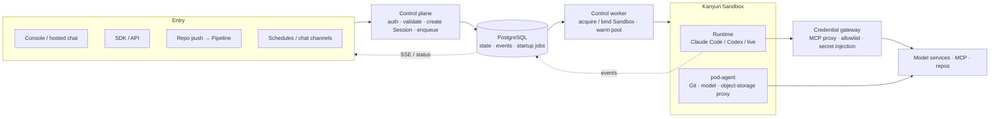

# Hi, I'm Kris

**AI Infra Lead @ Yuanfudao (猿辅导 / Kanyun)** · Beijing
GitHub [@krislavten](https://github.com/krislavten) · X [@kris_wpf](https://x.com/kris_wpf)

**[中文版本 →](./README.zh-CN.md)**

> I build agent apps and the platform under them — and a team of agents writes the code.

I run AI infrastructure at Yuanfudao and explore where agents can be used in the business. On the application side: **Rush**, our enterprise AI app platform. On the platform side: **AgentHub**, our enterprise agent platform. What we learn in Rush becomes platform capabilities, and the platform gets the next agent app shipped faster.

I'm also a heavy agent user — 200B+ tokens a month. Agents now write almost all of my code; my focus has shifted to designing systems, setting rules and judging results.

## Selected Work

### AgentHub — enterprise agent platform (2026–present, lead)

**The problem:** Getting one agent running is no longer hard; managing a fleet of them is. Changes have no versions or review, quality has no objective measure, and when production breaks nobody can say which change caused it.

**Key decisions:**

- **Agents as code.** Agent definitions live as files in a Git repo; every change goes through commit, review and a pipeline, so it can be traced and rolled back.
- **Evaluation before release.** Every version is evaluated before it deploys to production. The goal is for "no unevaluated version ships" to be enforced by the system, not by process.
- **Platform and business, separated.** Business teams own only the role, skills and business tools; the platform provides runtime, model access, credentials, releases and session management. Models are vendor-neutral.
- **Observability as its own module.** Sessions, events and traces aren't only for debugging — they're also where new eval cases come from.

**Results:**

- The platform serves **100% of production traffic**; Rush runs on it.
- Beyond coding tasks, the platform supports voice agents (speech in/out and real-time voice conversation) and chat channels such as WeCom and Slack.
- [AgentHub Showcase](https://github.com/kanyun-ai-explore/agenthub-showcase) has 10 agent apps across four scenarios — e-commerce, online education, language learning and production on-call — covering shopping, live lessons, homework help, real-time English voice conversation and on-call checks. Agent definitions, business tools and UI source are all open.

Runtime architecture

Requests are written to the state store and return immediately. Sandbox acquisition, startup and health checks run in background orchestration; runtime events are written back to the platform and pushed to pages and API callers over SSE. Agent definitions contain only credential references; the gateway injects credentials at runtime.

### Rush — enterprise AI app platform (core maintainer)

Users describe what they want in natural language, and Rush generates a full web app with live preview. As of June 2026: **17,000+ projects and 3,000+ users** internally, with ~1,000 people creating projects each month. In H1 2026 I submitted 512 PRs to the Rush repo.

### Building with an agent team (H2 2026–present)

Almost all of AgentHub's code is written by a team of agents — Claude Code, Codex and opencode sessions. I set the rules, make the final calls and grant access.

- **Output** — July to early October 2026, the team merged **~1,600 PRs** into AgentHub, 1,000+ of them in September.
- **Quality** — before merge, every PR must pass four independent checks on the same commit: adversarial code review, deep review, mutation testing and CI. A task is done only when it's deployed to production and regression checks pass.
- **Stable operation** — each role's boundaries live in a file that's reloaded automatically when a session restarts. Mistakes the team has made are recorded as rules in role files or hooks. For this I wrote the team's messaging layer, kris-team, and built a task board on a fork of herdr-board.

### Octopus — company-wide observability platform (4 years)

RUM, logs, traces, alerts and LLM observability.

## Open Source

- **[codeontic](https://github.com/krislavten/codeontic)** — At a deploy review, ops asked: "do you still have control over code that agents mostly wrote?" codeontic is my answer: a machine-checkable behavioral model above the code, with a deterministic checker verifying on every PR that the code still conforms to it.
- **[Sparring](https://github.com/krislavten/sparring)** — a second AI that reviews Claude's code specifically to find defects; one of the agent team's merge checks.
- **[OpenRush](https://github.com/kanyun-rush/open-rush)** — open-source, self-hosted managed-agents platform for Claude Code.
- **[cowork-mdm](https://github.com/krislavten/cowork-mdm)** — enterprise deployment toolkit for Claude Desktop.
- **Other agent tools** — [ai-sdk-provider-dsh](https://github.com/krislavten/ai-sdk-provider-dsh), [ai-explore-review-loop-plugin](https://github.com/kanyun-inc/ai-explore-review-loop-plugin), and a set of CLIs that let agents operate our production systems (observability, ops, docs and Jira; published to npm).

## Working Principles

- **Agents writing code is settled.** So "in control of the code" no longer means "someone has read every line"; it means "how the system should behave is written somewhere a machine can check."
- **Define "correct" before handing work to an agent.** Acceptance criteria, merge rules and role boundaries are written as files and enforced by scripts, not by memory.
- **Rules come from real mistakes.** Every rule should be able to name the mistake that led to it.
- **Build the tools, and use them.** AgentHub, Rush and the team tooling are written by agents, and I use them every day.

## Tech

`TypeScript` · `Node.js` · `React` · `Next.js` · `Hono` · `PostgreSQL` · `Redis` · `Docker` · `Kubernetes`
`Claude Agent SDK` · `AI SDK` · `MCP` · `Claude Code` · `Codex` · `OpenTelemetry`

## Contact

- Email — [adwerrd@hotmail.com](mailto:adwerrd@hotmail.com)
- X — [@kris_wpf](https://x.com/kris_wpf)
- 小红书 — @kriiswu
