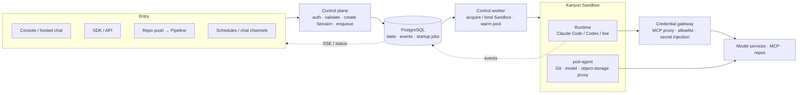

# Hi, I'm Kris 👋

**AI Infra Lead @ Yuanfudao (猿辅导 / Kanyun)** · Beijing
GitHub [@krislavten](https://github.com/krislavten) · X [@kris_wpf](https://x.com/kris_wpf)

🌏 **[中文版本 →](./README.zh-CN.md)**

> From observability engineer to AI engineer. Right now: building AgentHub, our enterprise agent platform — and running a team of agents that builds it.

I don't train models — I build agents and the infrastructure they need: how an agent is defined, evaluated, run, and traced back when something goes wrong. A heavy user myself — 200B+ tokens a month.

In H2 2026 my focus moved from Rush to AgentHub, and day-to-day development moved to a team of Claude Code, Codex and opencode sessions. I set the rules, review the results, and ship.

## 🚀 What I'm Building

### AgentHub — enterprise agent platform

**AgentHub** (repo codename Pilot) is our full-lifecycle agent platform. The goal: **10× faster agent delivery** — developers own the role, skills and business tools; the platform owns the runtime, model access, releases and sessions.

Requests are written to the state store and return immediately; sandbox acquisition, startup and health checks run in the background, and runtime events flow back to the platform and out over SSE.

**Why.** The question has shifted from "can we get an agent running?" to "how do we manage a fleet of them?":

- Prompts, tools and skills scattered across UI forms and databases — no versions, no review, no rollback.
- No repeatable way to tell whether a change made an agent better or worse — just manual trial and gut feel.
- When production breaks, no way to say which version, which change, and whether it was ever evaluated.

**How.** Four modules — **Define, Evaluate, Run, Observe** — with Git carrying every change from definition through evaluation to production. Runtime data stays out of Git; Observe collects it and feeds it back into eval cases and definitions.

- **Define (Agent-as-Code)** — agents live as files (`agent.yaml` …) in Git; UI edits, AI-generated changes and user pushes all become commits, and the DB holds a read-only projection. Each push runs a commit pipeline: resolve → freeze inputs → bake image → Revision → deploy to the test Stage → eval. Design approved, in progress.
- **Evaluate** — EvalRun worker and five graders (`transcript` / `file` / `llm` / `script` / `reply`) live, with eval verdicts shown in the pipeline. Production deploy gate and online sampling in progress — so "no eval, no production" becomes a system rule, not a convention.
- **Run** — shipped, serving **100% of production traffic**. Agents run in Kanyun Sandbox containers as `managed_agent` (platform-run runtime) or `self_managed` (the business owns the loop and sessions).
  - Four-layer resource model (Project / Workload / Revision / Session), Revision / Stage deployments, resumable SSE event stream.
  - Session pre-warming pool: sandbox, worker and business init done ahead of time, so a request just claims a ready session. Rush is the first consumer.
  - Vendor-neutral: model services can plug in models from any vendor.
  - Credential gateway: agent definitions carry only `sec_*` references — plaintext never enters Git or the definition; secrets are stored encrypted and injected at runtime. MCP, model, repo and object-storage access all goes through the gateway and pod-agent proxies, with allowlisted egress.
  - Voice agents: add a `voice` block to a regular agent to accept recordings (auto-transcribed) and speak its replies; `format: live` agents do real-time voice conversation with no sandbox — a shared platform service calls the model directly. Both use the same session API.
  - Declare `channels:` in `agent.yaml` to put an agent on WeCom, Slack and other chat channels; or start sessions on a cron schedule, and get a webhook at the end of every turn.
  - Public SDK `@kanyun-ai-infra/agenthub` and a CLI.
- **Observe** — sessions, events, traces and artifacts available; linking them to versions, deployments and eval results in progress. Plus per-project usage billing and a separately deployed public status page that stays up when the portal doesn't.
- **Console assistant** — a built-in chat assistant ("Pilot") that loads skills for the page you're on and answers from platform data; any change it proposes is a draft or confirm card that the user applies.

**Engineering milestones:**

- **v1 → v2 migration finished** — v1 portal deleted in September 2026, v1/v2 traffic-split router deleted on Sept 27; all new work is v2-only.
- **Spec-first** — every feature starts as a behavioral spec with MUST / MUST NOT clauses and test points, then agents implement it; the repo's `AGENTS.md` is the standing map for coding agents.
- **Pace** — July – early October 2026: **~1,600 PRs** merged under my name, 1,000+ in September alone — almost all written by the agent team below.

**[AgentHub Showcase](https://github.com/kanyun-ai-explore/agenthub-showcase)** — two end-to-end apps built on AgentHub, with agent definitions, business tools and UI source: e-commerce (shopping + merchant assistants, after Anthropic's [commerce-agents](https://github.com/anthropics/commerce-agents)) and online education (course advising → in-class tutoring → weekly reports for teachers).

### The agent team that builds AgentHub

I'm the owner; agents do the work.

- **Roles** — a `lead` session dispatches cards, rules on merges and runs releases; `card` sessions each take one task; `hermes` does deep PR review; `gate` runs mutation tests and checks invariants; `pm` sessions split and accept whole features. Each role's boundaries live in a role file, re-injected by a hook on every start, resume and compaction.
- **Merge bar** — every PR must pass four gates **on the same head commit**: Sparring adversarial review, hermes review, gate mutation testing, and CI. A task is done only when it's in production and regression checks are green.
- **kris-team** — the messaging layer I wrote for it: one inbox per Claude Code / Codex / opencode session, one CLI (`kt`); a busy agent gets the message at its next tool boundary, an idle one is woken. The lead session writes a handoff and clears its own context past a usage threshold.
- **Board** — tasks dispatched via my [herdr-board](https://github.com/krislavten/herdr-board) fork: a card entering "In progress" starts a Claude Code session, which hands the card back when done. The fork adds Claude provider config and per-session launch args.
- **Model tiers** — every card names its model tier: mechanical work goes to DeepSeek (`deepseek-v4-flash`), harder work to Opus and others.

### Open Source & Tools

- **[codeontic](https://github.com/krislavten/codeontic)** — a behavioral model above the code: state machines, end-to-end flows and hand-off seams in YAML, bound to real code symbols, checked on every PR by a deterministic, zero-LLM checker. It started from one deploy-review question: *"do you still have control over code an agent mostly wrote?"*
- **[ai-sdk-provider-dsh](https://github.com/krislavten/ai-sdk-provider-dsh)** — AI SDK provider that wraps a DeepSeek Harness (`dsh`) runtime as a `LanguageModel`, driven by `generateText` / `streamText`.
- **[ai-explore-review-loop-plugin](https://github.com/kanyun-inc/ai-explore-review-loop-plugin)** — Claude Code plugin: a coding session waits for the exact-head PR review and continues the review → fix → push loop without polling GitHub.
- **[Sparring](https://github.com/krislavten/sparring)** — adversarial AI code review: a second AI (Cursor / Codex / GLM / Claude) hunts bugs in Claude's output. Now one of the team's four merge gates.
- **[OpenRush](https://github.com/kanyun-rush/open-rush)** — open-source, self-hosted managed-agents platform for Claude Code: sandboxed execution, Agent/Skill/MCP registry, dual-layer credential Vault, streaming event contract.
- **[cowork-mdm](https://github.com/krislavten/cowork-mdm)** — Claude Desktop enterprise deployment toolkit (reverse-engineered 51 MDM keys).

### Agent Toolchain — CLI + MCP

Tools so AI agents can operate real systems — all published to npm:

- **octo-cli** — Observability (logs / alerts / traces / metrics / RUM / topology)
- **conso-cli** — Console-platform ops (deploy / services / pods / resources)
- **docz-cli** / **rush-shimo-cli** — Company-docs access (DocSync / Shimo)
- **jira-cli** — Jira for agents (issue / sprint / board)
- **qlint** — Observability query linter — helps agents generate correct queries
- **reskill** *(co-built)* — Git-based skills package manager for AI agents — `npx reskill install`
- **agent-aware** — Lets agents perceive user behavior (clicks / scroll / frustration) in web apps

## 🧭 How I Work

- **Verifier first.** Define "how do we know it's right" before any agent writes code. Merge bars, task-card templates and role boundaries are files enforced by hooks and scripts, not by memory.
- **Rules come from real failures.** When the agent team gets something wrong, it becomes a dated, sourced decision in the runbook, then lands in a role file or a hook.
- **I build the tools and live in them.** AgentHub, Rush, OpenRush and kris-team are all agent-built and used every day.

## 🛠 Before

- **Rush** (my focus in H1 2026) — enterprise AI app platform: describe what you want, get a full web app with live preview. As of June 2026: **17,000+ projects, 3,000+ users, 500K+ messages** internally; ~1,000 monthly active creators, 400+ agents. Core maintainer — 512 PRs in H1 2026; still landing some infra and CI changes.
- **TentaClaw** — tried to close the Issue → Code → Deploy → Observe → Feedback loop, one agent per repo. No longer maintained; agent observability now lives in AgentHub's Observe module.
- **Octopus** (4 years, before AI) — Yuanfudao's company-wide observability platform (RUM / Logs / Trace / Alerts / LLM Observability) — the groundwork for AgentHub's Observe module.

## 💻 Tech

`TypeScript` · `Node.js` · `React` · `Next.js` · `Hono` · `PostgreSQL` · `Drizzle` · `pg-boss` · `Redis` · `Docker` · `Kubernetes`
`Claude Agent SDK` · `AI SDK` · `MCP` · `Claude Code` · `Codex` · `opencode` · `OpenTelemetry` · `pnpm/turborepo`

## 📫 Connect

- Email — [adwerrd@hotmail.com](mailto:adwerrd@hotmail.com)
- X — [@kris_wpf](https://x.com/kris_wpf)
- 小红书 — @kriiswu
