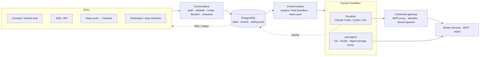

# Hi, I'm Kris 👋

**AI Infra Lead @ Yuanfudao (猿辅导 / Kanyun)** · Beijing
GitHub [@krislavten](https://github.com/krislavten) · X [@kris_wpf](https://x.com/kris_wpf)

🌏 **[中文版本 →](./README.zh-CN.md)**

> I build agent infrastructure — with a team of agents.

I run AI infrastructure at Yuanfudao; my main product is **AgentHub**, our enterprise agent platform. I don't train models. I care about how agents are defined, evaluated, shipped, and traced back when something goes wrong.

I'm also a heavy agent user — 200B+ tokens a month. Agents now write almost all of my code; my job has shifted to designing systems, setting rules and judging results.

Before AI, I spent 4 years building an observability platform. That shapes how I see agents: you can't manage what you can't see.

## 🚀 Selected Work

### AgentHub — enterprise agent platform (2026–present, lead)

**The problem.** Getting one agent running is easy now. Managing a fleet is not: changes have no versions or review, quality has no objective measure, and when production breaks nobody can say which change did it.

**Key decisions I made:**

- **Agents as code.** Agent definitions live as files in Git; every change goes through commit, review and a pipeline, so it can be traced and rolled back.
- **No eval, no production.** Every version is evaluated before it deploys — the goal is for that to be a system rule, not a convention.
- **Platform vs. business.** Teams own the role, skills and business tools; the platform owns runtime, model access, credentials, releases and sessions — vendor-neutral on models.
- **Observability as a first-class module.** Sessions, events and traces aren't just for debugging — they're where new eval cases come from.

**Results:**

- The Run module is shipped and serves **100% of the platform's production traffic**; Rush runs on it.
- Beyond coding tasks: voice agents (speech in/out and real-time voice conversation) and channels like WeCom and Slack.
- [AgentHub Showcase](https://github.com/kanyun-ai-explore/agenthub-showcase) — two end-to-end apps (e-commerce, online education) with agent definitions, business tools and UI source.

Runtime architecture

Requests are written to the state store and return immediately; sandbox acquisition, startup and health checks run in the background, and runtime events flow back and out over SSE. Definitions reference credentials only; the gateway injects them at runtime.

### Building with an agent team (H2 2026–present)

Almost all of AgentHub's code is written by a team of Claude Code, Codex and opencode sessions. I set the rules, make the final calls and grant access.

- **Output** — July to early October 2026, the team merged **~1,600 PRs** into AgentHub, 1,000+ in September alone.
- **Quality** — every PR must pass four independent checks on the same commit before merge: adversarial code review, deep review, mutation testing and CI. A task is done only when it's in production and regression checks are green.
- **Keeping it stable** — each role's boundaries live in a file that's reloaded whenever a session restarts; every mistake the team makes becomes a rule in a file or a hook. I built the team's messaging layer (kris-team) and task board (a herdr-board fork) for this.

### Rush — enterprise AI app platform (H1 2026 focus, core maintainer)

Describe what you want, get a full web app with live preview. As of June 2026: **17,000+ projects, 3,000+ users** internally, ~1,000 monthly active creators. 512 PRs from me in H1 2026.

### Octopus — company-wide observability platform (4 years)

RUM, logs, traces, alerts and LLM observability.

## 🛠 Open Source

- **[codeontic](https://github.com/krislavten/codeontic)** — At a deploy review, ops asked: *"do you still have control over code an agent mostly wrote?"* This is my answer: a machine-checkable behavioral model above the code, checked against the code on every PR by a deterministic checker.
- **[Sparring](https://github.com/krislavten/sparring)** — a second AI that hunts bugs in Claude's code; one of the agent team's merge checks.
- **[OpenRush](https://github.com/kanyun-rush/open-rush)** — open-source, self-hosted managed-agents platform for Claude Code.
- **[cowork-mdm](https://github.com/krislavten/cowork-mdm)** — enterprise deployment toolkit for Claude Desktop.
- **[ai-sdk-provider-dsh](https://github.com/krislavten/ai-sdk-provider-dsh)**, **[ai-explore-review-loop-plugin](https://github.com/kanyun-inc/ai-explore-review-loop-plugin)** and other agent tooling, plus a set of CLIs that let agents operate our production systems (observability, ops, docs, Jira; published to npm).

## 🧭 What I Believe

- **Agents writing code is a one-way door.** So "in control of the code" can't mean "someone read every line" — it has to mean "how the system should behave is written somewhere a machine can check."
- **Define "correct" before an agent starts.** Acceptance criteria, merge rules and role boundaries are files enforced by scripts, not memory.
- **Rules come from real failures.** Every rule should be able to name the mistake that earned it.
- **Build the tools, live in them.** AgentHub, Rush and the team tooling are agent-built, and I use them every day.

## 💻 Tech

`TypeScript` · `Node.js` · `React` · `Next.js` · `Hono` · `PostgreSQL` · `Redis` · `Docker` · `Kubernetes`
`Claude Agent SDK` · `AI SDK` · `MCP` · `Claude Code` · `Codex` · `OpenTelemetry`

## 📫 Connect

- Email — [adwerrd@hotmail.com](mailto:adwerrd@hotmail.com)
- X — [@kris_wpf](https://x.com/kris_wpf)
- 小红书 — @kriiswu
