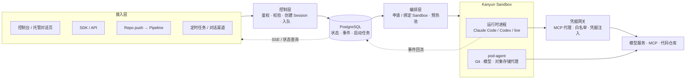

# 你好，我是 Kris（吴鹏飞）

**AI Infra Lead @ 猿辅导（看云 / Kanyun）** · 北京
GitHub [@krislavten](https://github.com/krislavten) · X [@kris_wpf](https://x.com/kris_wpf)

**[English →](./README.md)**

> 我做 Agent 应用，也做支撑它们的平台；写代码的是一支 Agent 团队。

我在猿辅导负责 AI 基础设施，同时探索 Agent 能用在哪些业务上。应用侧是 **Rush** 和一批 Agent 应用；平台侧是企业 Agent 平台 **AgentHub**。应用中积累的经验做成平台能力，平台再让新的 Agent 应用更快上线。

我也是 Agent 的重度用户，每月消耗超过 2,000 亿 token。现在我的代码几乎都由 Agent 编写，我的工作重心转向设计系统、制定规则和判断结果。

## 代表工作

### AgentHub：企业 Agent 平台（2026 年至今，负责人）

**要解决的问题：** 跑起来一个 Agent 已经不难，难的是管理一批 Agent。改动没有版本和评审，效果好坏没有客观评估，生产环境出了问题也说不清是哪次改动造成的。

**关键决策：**

- **Agent 即代码。** Agent 定义以文件形式存放在 Git 仓库中，每次改动都经过 commit、评审和流水线，可以追溯和回滚。
- **评估是上线的前提。** 每个版本先评估，再部署到生产环境。目标是由系统强制执行「未经评估的版本不能上线」，而不是依靠流程约定。
- **平台与业务分离。** 业务方只负责角色、技能和业务工具；运行环境、模型接入、凭据、发布和会话管理由平台统一提供。模型不绑定厂商。
- **可观测是独立模块。** 会话、事件和 Trace 不只用于排障，也是新评估用例的来源。

**结果：**

- 平台已承接全部生产流量，Rush 已接入。
- 除编程类任务外，平台还支持语音 Agent（语音输入输出和实时语音对话），并可接入企业微信、Slack 等对话渠道。
- [AgentHub Showcase](https://github.com/kanyun-ai-explore/agenthub-showcase) 收录了电商、在线教育、语言学习和生产值班四个场景的 10 个 Agent 应用，覆盖导购、上课、作业批改、英语实时语音对话和值班巡检。Agent 定义、业务工具和界面源码全部公开。

运行架构

请求写入状态库后立即返回。Sandbox 的申请、启动和健康检查由后台编排完成；运行时事件写回平台，再通过 SSE 推送给页面和 API 调用方。Agent 定义中只包含凭据引用，凭据在运行时由网关注入。

### Rush：企业级 AI 应用平台（核心维护者）

用户用自然语言描述需求，Rush 生成带实时预览的完整 Web 应用。截至 2026 年 6 月，公司内部累计超过 17,000 个项目、3,000 名用户，每月约 1,000 人在平台上创建项目。2026 年上半年，我在 Rush 仓库提交了 512 个 PR。

### 用 Agent 团队做研发（2026 年下半年起）

AgentHub 的代码几乎都由一支 Agent 团队编写。团队由 Claude Code、Codex 和 opencode 会话组成，我负责制定规则、做最终决策和授权。

- **产出**：2026 年 7 月至 10 月上旬，这支团队在 AgentHub 仓库合入约 1,600 个 PR，其中 9 月超过 1,000 个。
- **质量**：每个 PR 合并前，必须在同一个 commit 上通过四道独立检查——对抗式代码审查、深度审查、变异测试和 CI。任务部署到生产环境且回归检查通过，才算完成。
- **稳定运转**：每个角色的职责边界写在文件中，会话重启后自动重新加载。团队犯过的错记录为规则，写入角色文件或 hook。为此，我编写了团队消息层 kris-team，并基于 herdr-board 的 fork 搭建了任务看板。

### Octopus：公司级可观测平台（4 年）

覆盖 RUM、日志、Trace、告警和 LLM 可观测。

## 开源项目

- **[codeontic](https://github.com/krislavten/codeontic)**：一次上线评审中，运维问：「大部分由 Agent 写的代码，你们还控制得住吗？」codeontic 是我的回答：在代码之上维护一层机器可核对的行为模型，每个 PR 都由确定性检查器核对代码是否仍然符合模型。
- **[Sparring](https://github.com/krislavten/sparring)**：让另一个 AI 专门审查 Claude 写的代码并找出缺陷，是 Agent 团队的合并检查之一。
- **[OpenRush](https://github.com/kanyun-rush/open-rush)**：开源、可自部署的 Claude Code 托管 Agent 平台。
- **[cowork-mdm](https://github.com/krislavten/cowork-mdm)**：Claude Desktop 的企业批量部署工具。
- **其他 Agent 工具**：[ai-sdk-provider-dsh](https://github.com/krislavten/ai-sdk-provider-dsh)、[ai-explore-review-loop-plugin](https://github.com/kanyun-inc/ai-explore-review-loop-plugin)，以及一组让 Agent 操作公司生产系统的 CLI（可观测、运维、文档和 Jira，已发布到 npm）。

## 工作原则

- **Agent 写代码已成定局。** 因此「控制住代码」不再意味着「有人读过每一行」，而是「系统应该如何运转，写在机器可核对的地方」。
- **先定义怎样算对，再交给 Agent。** 验收标准、合并规则和角色边界都写成文件，由脚本执行，不依赖记忆。
- **规则来自真实的错误。** 每条规则都应能说明是哪一次错误促成的。
- **工具自己造，也自己用。** AgentHub、Rush 和团队工具都由 Agent 编写，我每天都在使用。

## 技术栈

`TypeScript` · `Node.js` · `React` · `Next.js` · `Hono` · `PostgreSQL` · `Redis` · `Docker` · `Kubernetes`
`Claude Agent SDK` · `AI SDK` · `MCP` · `Claude Code` · `Codex` · `OpenTelemetry`

## 联系方式

- 邮箱：[adwerrd@hotmail.com](mailto:adwerrd@hotmail.com)
- X：[@kris_wpf](https://x.com/kris_wpf)
- 小红书：@kriiswu
