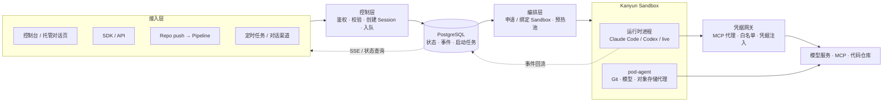

# 你好，我是 Kris（吴鹏飞）

**AI Infra Lead @ 猿辅导（看云 / Kanyun）** · 北京
GitHub [@krislavten](https://github.com/krislavten) · X [@kris_wpf](https://x.com/kris_wpf)

**[English →](./README.md)**

> 我做 Agent 基础设施，也用一支 Agent 团队来做它。

我在猿辅导负责 AI 基础设施，主要产品是企业 Agent 平台 **AgentHub**。我不训练模型，关心的是 Agent 怎么定义、怎么评估、怎么上线，以及出了问题怎么归因。

我也是 Agent 的重度用户，每月消耗超过 2,000 亿 token。现在我写的代码几乎都由 Agent 完成，我的工作重心变成了设计系统、制定规则和判断结果。

转向 AI 之前，我做了 4 年可观测平台。这段经历决定了我看 Agent 的角度：先能看清它在做什么，才谈得上管理它。

## 代表工作

### AgentHub：企业 Agent 平台（2026 年至今，负责人）

**要解决的问题。** Agent 越来越容易跑起来，难的是管理一批 Agent：改动没有版本和评审，好坏没有客观评估，线上出问题说不清是哪次改动造成的。

**我做的关键决策：**

- **Agent 即代码。** Agent 的定义以文件形式存放在 Git 仓库中，所有改动都经过 commit、评审和流水线，可以追溯和回滚。
- **评估是上线的前提。** 每个版本先跑评估，再部署到 production。目标是让「没评估过的版本不能上线」由系统强制执行，而不是靠流程约定。
- **平台和业务分开。** 业务方只负责角色、技能和业务工具；运行环境、模型接入、凭据、发布和会话管理由平台统一承担，模型不绑定厂商。
- **可观测是独立模块。** 会话、事件和 Trace 不只用来排障，也是新评估用例的来源。

**结果：**

- 运行模块已交付，承接平台全部线上流量，Rush 已接入。
- 除了编程类任务，平台还支持语音 Agent（语音输入输出和实时语音对话），可以接入企业微信、Slack 等渠道。
- [AgentHub Showcase](https://github.com/kanyun-ai-explore/agenthub-showcase) 公开了电商和在线教育两个完整案例，包含 Agent 定义、业务工具和界面源码。

运行架构

请求写入状态库后立即返回，Sandbox 的申请、启动和健康检查由后台编排推进；运行时事件写回平台，再通过 SSE 推给页面和 API 调用方。凭据在定义中只以引用出现，运行时由网关注入。

### 用 Agent 团队做研发（2026 年下半年起）

AgentHub 的代码几乎都由一支 Agent 团队编写。团队由 Claude Code、Codex 和 opencode 会话组成，我负责定规则、做最终决策和授权。

- **结果**：2026 年 7 月至 10 月上旬，这支团队在 AgentHub 仓库合入了约 1,600 个 PR，其中 9 月单月超过 1,000 个。
- **怎么保证质量**：每个 PR 合并前，要在同一个 commit 上通过四道独立检查：对抗式代码审查、深度审查、变异测试和 CI。任务只有上线到 production 且回归检查通过才算完成。
- **怎么让团队稳定运转**：每个角色的职责边界写在文件里，会话重启后自动重新加载；团队犯过的错会记成规则，落到文件或 hook 中。为此我写了团队消息层 kris-team 和任务看板（基于 herdr-board 的 fork）。

### Rush：企业级 AI 应用平台（2026 年上半年重心，核心维护者）

用自然语言描述需求，就能生成带实时预览的完整 Web 应用。截至 2026 年 6 月，公司内部累计超过 17,000 个项目、3,000 名用户，每月约 1,000 人在平台上创建项目。2026 年上半年我在该仓库提交了 512 个 PR。

### Octopus：公司级可观测平台（4 年）

覆盖 RUM、日志、Trace、告警和 LLM 可观测。

## 开源项目

- **[codeontic](https://github.com/krislavten/codeontic)**：在一次上线评审中，运维问我们：「大部分由 Agent 写的代码，你们还控制得住吗？」codeontic 是我的回答：在代码之上维护一层机器可检查的行为模型，每个 PR 都由确定性检查器核对代码是否仍然符合模型。
- **[Sparring](https://github.com/krislavten/sparring)**：让另一个 AI 专门挑 Claude 写的代码的毛病，是上面 Agent 团队的合并检查之一。
- **[OpenRush](https://github.com/kanyun-rush/open-rush)**：开源、可自部署的 Claude Code 托管 Agent 平台。
- **[cowork-mdm](https://github.com/krislavten/cowork-mdm)**：Claude Desktop 的企业批量部署工具。
- **[ai-sdk-provider-dsh](https://github.com/krislavten/ai-sdk-provider-dsh)**、**[ai-explore-review-loop-plugin](https://github.com/kanyun-inc/ai-explore-review-loop-plugin)** 等 Agent 工具，以及一组让 Agent 能操作公司生产系统的 CLI（可观测、运维、文档、Jira，已发布到 npm）。

## 我的想法

- **Agent 写代码已经回不去了。** 所以「控制住代码」不能再指「有人读过每一行」，而是指「系统该怎么运转，写在一个机器能核对的地方」。
- **先定义怎么算对，再让 Agent 做。** 验收标准、合并规则和角色边界都写成文件，由脚本执行，不靠记忆。
- **规则从真实的错误中来。** 每条规则都应该能说出是哪次出错换来的。
- **工具自己造，也自己用。** AgentHub、Rush 和团队工具都由 Agent 写成，我每天都在用。

## 技术栈

`TypeScript` · `Node.js` · `React` · `Next.js` · `Hono` · `PostgreSQL` · `Redis` · `Docker` · `Kubernetes`
`Claude Agent SDK` · `AI SDK` · `MCP` · `Claude Code` · `Codex` · `OpenTelemetry`

## 联系方式

- 邮箱：[adwerrd@hotmail.com](mailto:adwerrd@hotmail.com)
- X：[@kris_wpf](https://x.com/kris_wpf)
- 小红书：@kriiswu
