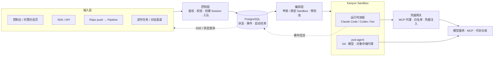

# 你好，我是 Kris（吴鹏飞）

**AI Infra Lead @ 猿辅导（看云 / Kanyun）** · 北京
GitHub [@krislavten](https://github.com/krislavten) · X [@kris_wpf](https://x.com/kris_wpf)

**[English →](./README.md)**

> 从可观测工程师转为 AI 工程师。现在主要做两件事：搭建企业 Agent 平台 AgentHub，以及用一支 Agent 团队把这个平台写出来。

我不训练模型，做的是 Agent 和 Agent 需要的基础设施：Agent 怎么定义、怎么评估、怎么运行、出了问题怎么归因。我自己也是 Agent 的重度用户，每月消耗超过 2,000 亿 token。

2026 年下半年的重心从 Rush 转到 AgentHub，同时把日常开发交给一支由 Claude Code、Codex 和 opencode 会话组成的 Agent 团队，自己负责定规则、审结果和发布。

## 在做什么

### AgentHub：企业 Agent 平台

**AgentHub**（仓库代号 Pilot）是公司的全生命周期 Agent 平台。目标是让 Agent 的交付效率提升 10 倍：开发者只负责角色、技能和业务工具，运行环境、模型接入、版本发布和会话管理由平台承担。

请求写入状态库后立即返回，Sandbox 的申请、启动和健康检查由后台编排推进；运行时事件写回平台，再通过 SSE 推给页面和 API 调用方。

**为什么做。** 企业面对的问题已经从「能不能跑起来一个 Agent」变成「怎么管理一批 Agent」：

- Prompt、工具和技能散落在界面表单和数据库里，改动没有版本、没有评审、无法回滚。
- Agent 改完之后变好还是变差，没有可重复的评估方法，只能靠人工试用。
- 线上出了问题，说不清是哪个版本、哪次改动、是否评估过。

**怎么做。** AgentHub 分为定义、评估、运行和观测四个模块，用 Git 串起「定义 → 评估 → 部署到 production」的变更流程；运行数据不进 Git，由观测模块收集后反过来补充评估用例和定义。

- **定义（Agent-as-Code）**：Agent 以 `agent.yaml` 等文件存放在 Git 仓库中，界面编辑、AI 生成和用户推送都形成 commit，数据库只保存只读投影。每次 push 触发提交流水线：解析 commit、冻结构建输入、构建镜像、生成 Revision、部署到 test Stage，再运行评估。方案已确定，正在实施。
- **评估**：EvalRun worker 和五类 Grader（`transcript`、`file`、`llm`、`script`、`reply`）已上线，评估结论已显示在流水线中。production 部署门禁和线上采样还在开发中，目标是让「未完成评估的版本不能上线」由系统强制执行。
- **运行**：已交付，承接了线上全部流量。Agent 在 Kanyun Sandbox 容器中执行，支持两类 workload：平台托管运行时的 `managed_agent`，以及业务自己管理循环和会话的 `self_managed`。
  - Project / Workload / Revision / Session 四层资源模型，Revision 与 Stage 部署，可续传的 SSE 事件流。
  - 会话预热池：沙箱、worker 和业务初始化提前完成，请求到来时只需领取一个就绪会话。Rush 是第一个接入方。
  - 模型不绑定厂商：模型服务可以接入任意厂商的模型。
  - 凭据网关：Agent 定义里只写 `sec_*` 引用，明文不进 Git、不进定义，加密存储在平台上，运行时才注入。访问 MCP、模型、代码仓库和对象存储都经过网关和 pod-agent 代理，按白名单控制出站。
  - 语音 Agent：普通 Agent 在 `agent.yaml` 里声明 `voice` 段，就能接收录音（自动转写）并把回复合成为语音；`format: live` 的 Agent 用于实时语音对话，不建沙箱，由平台的共享服务直接调用模型。两种形态使用同一套会话 API。
  - 在 `agent.yaml` 里声明 `channels:` 即可把 Agent 接入企业微信、Slack 等对话渠道；也可以按 cron 定时创建会话，或在每轮结束时通过 Webhook 通知业务系统。
  - 对外提供 SDK `@kanyun-ai-infra/agenthub` 和 CLI。
- **观测**：会话、事件、Trace 和产物已经可以查看；与版本、部署和评估结果的关联正在完善。另有按项目分摊的用量账单，以及独立部署的公开状态页（门户故障时状态页仍然可用）。
- **控制台助手**：控制台内置一个名为 Pilot 的对话助手，按用户所在页面加载技能，可以直接回答平台数据问题。修改平台数据时只生成草稿或确认卡，由用户确认后执行。

**工程上做过的事：**

- **完成 v1 到 v2 的迁移**：2026 年 9 月删除 v1 门户，9 月 27 日删除 v1/v2 流量分流器，所有新功能只在 v2 上开发。
- **规格先行**：每个功能先写行为规格，规定 MUST / MUST NOT 条款和对应的测试点，再交给 Agent 实现；仓库里的 `AGENTS.md` 是给 coding agent 读的常驻规则和模块索引。
- **交付节奏**：2026 年 7 月至 10 月上旬，仓库合入了约 1,600 个以我署名的 PR，其中 9 月单月超过 1,000 个。这些 PR 绝大部分由下文的 Agent 团队完成。

**[AgentHub Showcase](https://github.com/kanyun-ai-explore/agenthub-showcase)** 公开了两个基于 AgentHub 构建的完整案例，包含 Agent 定义、业务工具和界面源码：

- 电商：参照 Anthropic 开源的 [commerce-agents](https://github.com/anthropics/commerce-agents)，在 AgentHub 上实现导购助手和商家助手。
- 在线教育：从课程咨询到课堂讲解，再到给老师的学习周报。

### Agent 团队：用 Agent 开发 AgentHub

AgentHub 的日常开发由一支 Agent 团队完成，我担任 owner，负责定规则、做最终决策和授权。

- **角色分工**：lead 会话负责派发任务、裁决合并和发布；card 会话各自完成一张任务卡；hermes 负责 PR 深度审查；gate 负责变异测试和不变量核验；pm 会话负责拆分和验收一整块功能。每个角色的边界写在角色文件里，会话启动、恢复和压缩后由 hook 重新注入。
- **合并标准**：每个 PR 必须在同一个 head commit 上通过四道检查才能合并——sparring 对抗式审查、hermes 审查、gate 变异测试和 CI。任务只有上线到 production 且回归检查通过才算完成。
- **kris-team**：为这支团队写的消息层。Claude Code、Codex 和 opencode 会话各有一个收件箱，通过同一个 CLI `kt` 收发消息；对方忙时消息在下一次工具调用时送达，空闲时直接唤醒。lead 会话在上下文用量超过阈值后自动写交接文档并清空上下文。
- **任务看板**：基于 [herdr-board](https://github.com/krislavten/herdr-board)（fork）派发任务：卡片进入「In progress」列即启动一个 Claude Code 会话，会话完成后自己交卡。fork 增加了 Claude 模型 provider 配置和会话启动参数。
- **模型分档**：每张任务卡标注模型档位。机械性任务交给 DeepSeek（`deepseek-v4-flash`），复杂任务交给 Opus 等模型。

### 开源与工具

- **[codeontic](https://github.com/krislavten/codeontic)**：在代码之上维护一层行为模型，用 YAML 描述系统中的状态机、端到端流程和模块交接点，并绑定到真实代码符号。每个 PR 由确定性检查器（不调用 LLM）核对代码是否仍然符合模型。起因是一次上线评审中的问题：「大部分由 Agent 写的代码，你们还控制得住吗？」
- **[ai-sdk-provider-dsh](https://github.com/krislavten/ai-sdk-provider-dsh)**：AI SDK provider，把 DeepSeek Harness（`dsh`）运行时封装成 AI SDK 的 `LanguageModel`，可以直接用 `generateText` / `streamText` 驱动。
- **[ai-explore-review-loop-plugin](https://github.com/kanyun-inc/ai-explore-review-loop-plugin)**：Claude Code 插件。编程会话可以等待针对当前 head commit 的 PR 审查结果，收到后继续「审查、修复、推送」的循环，不需要轮询 GitHub。
- **[Sparring](https://github.com/krislavten/sparring)**：对抗式 AI 代码审查插件，让另一个 AI（Cursor、Codex、GLM 或 Claude）专门检查 Claude 写的代码。现在是 Agent 团队合并标准中的一道检查。
- **[OpenRush](https://github.com/kanyun-rush/open-rush)**：开源、可自部署的 Claude Code 托管 Agent 平台，包括沙箱执行、Agent / Skill / MCP 注册表、双层凭据 Vault 和流式事件协议。
- **[cowork-mdm](https://github.com/krislavten/cowork-mdm)**：Claude Desktop 企业批量部署工具，逆向整理出 51 个 MDM 配置项。

### 给 Agent 用的 CLI 与 MCP

这些工具让 Agent 能直接操作公司的生产系统，均已发布到 npm：

- **octo-cli**：可观测数据查询，包括日志、告警、Trace、指标、RUM 和拓扑
- **conso-cli**：Console 平台运维，包括部署、服务、Pod 和资源
- **docz-cli** / **rush-shimo-cli**：读写公司文档（DocSync、石墨）
- **jira-cli**：Jira 的 issue、sprint 和 board 管理
- **qlint**：可观测查询语句的 linter，帮助 Agent 写出正确的查询
- **reskill**（共建）：Agent 技能包管理器，用法类似 npm：`npx reskill install`
- **agent-aware**：让 Agent 获取用户在网页中的操作（点击、滚动、反复尝试等），并据此修复问题

## 工作方式

- **先定义验收标准，再动手。** 先写清楚「怎么判断做对了」，再交给 Agent 实现。合并标准、任务卡模板和角色边界都写成文件，由 hook 和脚本执行，而不是靠记忆。
- **规则从实际问题中来。** Agent 团队犯过的错会在运行手册里记成一条带日期和出处的决策，再落到角色文件或 hook 中。
- **工具自己造，也自己用。** AgentHub、Rush、OpenRush、kris-team 都由 Agent 写成，并在日常开发中持续使用。

## 之前做过什么

- **Rush**（2026 年上半年的重心）：公司的企业级 AI 应用平台，用自然语言描述需求，即可生成带实时预览的完整 Web 应用。截至 2026 年 6 月，内部累计超过 17,000 个项目、3,000 名用户、50 万条消息，每月约 1,000 人在平台上创建项目，平台上有 400 多个 Agent。我是核心维护者，2026 年上半年在该仓库提交了 512 个 PR，下半年仍有少量基础设施和 CI 改动。
- **TentaClaw**：尝试把 Issue → Code → Deploy → Observe → Feedback 做成完整流程，每个仓库配一个 Agent。该项目已停止维护，Agent 的观测能力并入 AgentHub 的观测模块。
- **Octopus**（转向 AI 之前的 4 年）：公司级可观测平台，覆盖 RUM、日志、Trace、告警和 LLM 可观测。这段经历是 AgentHub 观测模块的基础。

## 技术栈

`TypeScript` · `Node.js` · `React` · `Next.js` · `Hono` · `PostgreSQL` · `Drizzle` · `pg-boss` · `Redis` · `Docker` · `Kubernetes`
`Claude Agent SDK` · `AI SDK` · `MCP` · `Claude Code` · `Codex` · `opencode` · `OpenTelemetry` · `pnpm/turborepo`

## 联系方式

- 邮箱：[adwerrd@hotmail.com](mailto:adwerrd@hotmail.com)
- X：[@kris_wpf](https://x.com/kris_wpf)
- 小红书：@kriiswu
